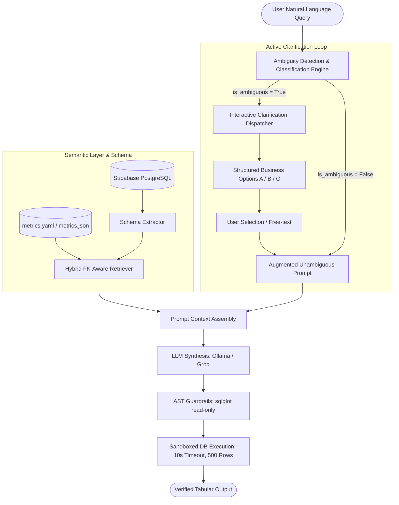

# ClarifySQL 🔍

> **Intelligent Natural Language to SQL with Active Ambiguity Resolution**

[](https://www.python.org/)
[](https://supabase.com)
[](https://docs.pydantic.dev/)
[](https://github.com/tobymao/sqlglot)
[](https://docs.pytest.org/)

---

## 📌 Problem Statement: The "Tutorial AI" vs. Production Gap

Standard Text-to-SQL pipelines work well on trivial, explicit questions (e.g., *"How many users registered in March 2024?"*). However, enterprise production systems fail catastrophically when presented with naturally underspecified, semantic, or ambiguous business questions (e.g., *"Show me last month's best customers"*).

When an ambiguous query is received, naive engines make arbitrary internal assumptions (hallucinating specific metrics like order counts vs. net spend vs. transaction frequency) and generate syntactically valid SQL that produces **confidently incorrect business numbers**. This leads to:
* **Silent Data Corruption:** High-stakes decisions made on miscalculated metrics.
* **Loss of Trust:** Stakeholders abandon self-service data tools after experiencing conflicting numbers.
* **Engineering Overhead:** Data teams spend hours debugging why an AI query conflicts with official financial reports.

**ClarifySQL** solves this problem by embedding a proactive **Clarification Engine** between natural language understanding and SQL synthesis. It identifies ambiguities across 4 core dimensions, prompts the user with structured, plain-English business options, and synthesizes verified, guardrailed SQL.

---

## 🏛️ System Architecture



---

## 🚀 Key Features

1. **Ambiguity Classification (ADCE):**
   - **Metric Ambiguity:** Subjective business terms (*"top"*, *"best"*, *"active"*, *"high-value"*).
   - **Temporal Ambiguity:** Unanchored dates or multiple timestamp columns (`order_date` vs. `payment_date`).
   - **Schema & Entity Ambiguity:** Overlapping column names and table entities.
   - **Granularity Ambiguity:** Unspecified grouping levels (account vs. transaction level).

2. **Dual-Model Schema Retrieval (SISL):**
   - **Baseline Lexical Keyword Retriever:** Fast token & synonym matching against tables, columns, and metric catalogs.
   - **Hybrid FK-Aware Retriever:** Employs an adaptive threshold ($\le 10$ tables auto-injected) and Foreign Key graph BFS traversal to guarantee intermediate join bridge tables (e.g., `orders` linking `customers` and `payments`) are never pruned.

3. **Dual YAML/JSON Semantic Layer:**
   - Certified business metrics as code (`gross_revenue`, `net_revenue`, `active_customer`, `top_customers`).
   - Table synonyms and human-readable column documentation.

4. **AST-Level Guardrails & Sandbox (SGES):**
   - Powered by `sqlglot` to strictly enforce read-only `SELECT` queries (blocking `DROP`, `DELETE`, `UPDATE`, `INSERT`, `ALTER`, `EXEC`).
   - Read-only execution with 10-second statement timeouts and 500-row result truncation.

5. **Dual LLM Provider Support:**
   - **Local Inference:** Ollama (optimized for RTX 3070 8GB VRAM using `llama3.1:8b` or `qwen2.5-coder:7b`).
   - **Production:** Groq Cloud (`llama-3.3-70b-versatile`).

---

## 📂 Project Structure

```
Text-to-SQL/
├── config/
│   ├── settings.py             # Pydantic BaseSettings (.env loading)
│   ├── metrics.yaml            # Semantic layer certified metrics (YAML)
│   └── metrics.json            # Semantic layer certified metrics (JSON)
├── clarifysql/
│   ├── schema/
│   │   ├── extractor.py        # PostgreSQL introspection & DDL caching
│   │   ├── semantic_layer.py   # Dual YAML/JSON catalog parser & validator
│   │   └── retriever.py        # Baseline Lexical & Hybrid FK-Aware Retrievers
│   ├── ambiguity/              # Ambiguity classification models & prompts (Module 3)
│   ├── llm/                    # Dual Ollama & Groq abstraction layer (Module 4)
│   ├── generator/              # SQL synthesis & sqlglot AST guardrails (Module 5)
│   ├── execution/              # Sandboxed execution & retry loop (Module 6)
│   ├── pipeline/               # Comparative evaluation pipelines (Module 7)
│   └── cli/                    # Rich interactive terminal interface (Module 8)
├── tests/
│   ├── test_semantic_layer.py  # Unit tests for Module 1
│   └── test_schema_retriever.py# Unit tests for Module 2
├── docs/
│   └── project_requirement_document.md
├── requirements.txt
└── .env.example
```

---

## 🛠️ Setup & Installation

### 1. Clone & Set Up Environment
```bash
git clone https://github.com/qasim233/ClarifySQL.git
cd ClarifySQL

# Create and activate virtual environment
python3.12 -m venv .venv
source .venv/bin/activate

# Install dependencies
pip install -r requirements.txt
```

### 2. Configure Environment
```bash
cp .env.example .env
# Edit .env with your Supabase credentials or LLM settings
```

### 3. Run Unit Tests
```bash
pytest -v tests/
```
